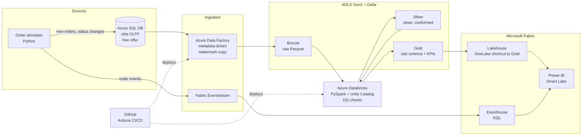

# ShopStream

An end-to-end e-commerce data platform on Azure, Databricks and Microsoft Fabric, built on the
[Olist Brazilian e-commerce dataset](https://www.kaggle.com/datasets/olistbr/brazilian-ecommerce)
(~100k orders, 2016–2018, 9 related tables).

It replicates what a real retail data team runs: an OLTP database that keeps changing, incremental
batch ingestion, a medallion lakehouse with data-quality gates, a real-time order feed, and a
Power BI layer the business uses — all deployed from Git.

## Architecture



| Layer | Service | What it does |
| --- | --- | --- |
| Source | Azure SQL Database (free offer) | Olist as a normalized OLTP schema; a simulator inserts new orders and moves statuses so there is real change to capture |
| Batch ingestion | Azure Data Factory | Metadata-driven pipeline; `updated_at` watermark per table → Parquet in Bronze |
| Lake | ADLS Gen2 (hierarchical namespace) | Bronze / Silver / Gold containers, Delta format from Silver up |
| Transform | Azure Databricks (Unity Catalog) | PySpark Bronze→Silver (types, dedupe, SCD2 customers) → Gold (fact_orders, fact_order_items, dims, KPIs); expectations-style DQ checks |
| Streaming | Fabric Eventstream → Eventhouse | Live order events, KQL for last-15-minute GMV and late-delivery alerts |
| Serving | Fabric Lakehouse + Power BI (Direct Lake) | OneLake shortcut to Gold (no copy), semantic model, executive + ops reports |
| DevOps | GitHub Actions | Lint + unit tests on every push; ADF Git integration; Databricks Asset Bundles |

## Repo layout

```
shopstream/
├── .github/workflows/ci.yml     # lint + unit tests on every push / PR
├── docs/                        # setup checklist, walkthroughs, architecture decisions (ADRs)
├── sql/source/                  # Azure SQL DDL, constraints, validation
├── scripts/                     # download_olist.py, load_olist_to_azuresql.py
├── simulator/                   # order + event generator (Day 3)
├── ingestion/adf/               # ADF pipelines (Git-integrated JSON)
├── databricks/                  # bundle, src/ transforms, notebooks, tests
├── fabric/                      # lakehouse, eventstream, semantic model notes
├── infra/                       # Bicep for the Azure resources
├── tests/                       # repo-level unit tests
└── data/raw/                    # Kaggle CSVs (gitignored)
```

## Quick start (Day 1: source database)

See [docs/01-load-olist-to-azure-sql.md](docs/01-load-olist-to-azure-sql.md).

```bash
python -m venv .venv && source .venv/bin/activate        # Windows: .venv\Scripts\activate
pip install -r requirements-dev.txt
python scripts/download_olist.py                          # needs ~/.kaggle/kaggle.json
# run sql/source/01_create_schema_and_tables.sql in SSMS
cp .env.example .env                                      # fill in server + credentials
python scripts/load_olist_to_azuresql.py
# run sql/source/02_constraints_and_indexes.sql, then 03_validate_load.sql
```

## Progress

- [x] Day 1 — accounts, repo, Olist loaded into Azure SQL DB
- [x] Day 2 — ADLS Gen2 + ADF metadata-driven incremental copy to Bronze (full load 1.55M rows; incremental proven: 50 + 10 rows)
- [ ] Day 3 — order simulator (OLTP changes + event stream)
- [ ] Bronze → Silver → Gold in Databricks with DQ checks
- [ ] Fabric Lakehouse shortcut, Eventstream/Eventhouse, Power BI
- [ ] CI/CD for ADF + Databricks, cost report, demo video

## Data licence

Olist dataset © Olist, published on Kaggle under CC BY-NC-SA 4.0. Raw data is not stored in this repo.
